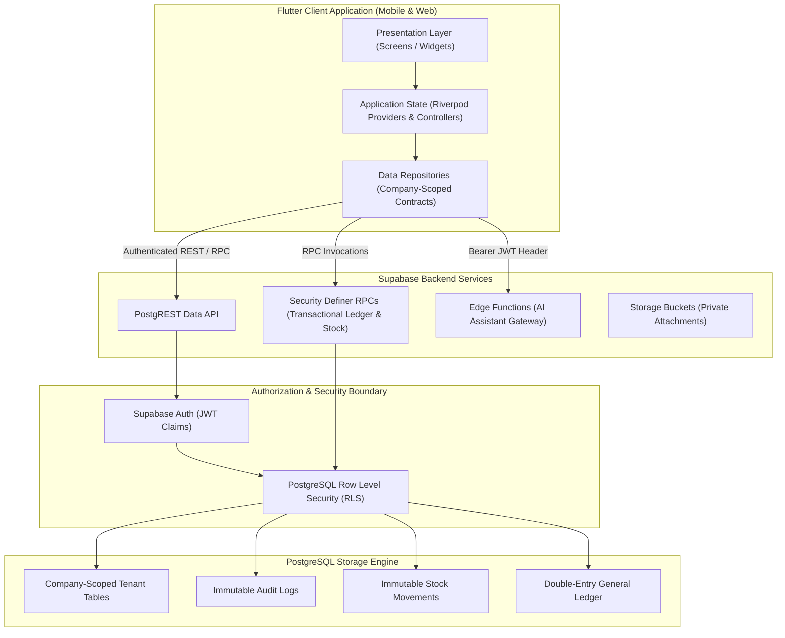
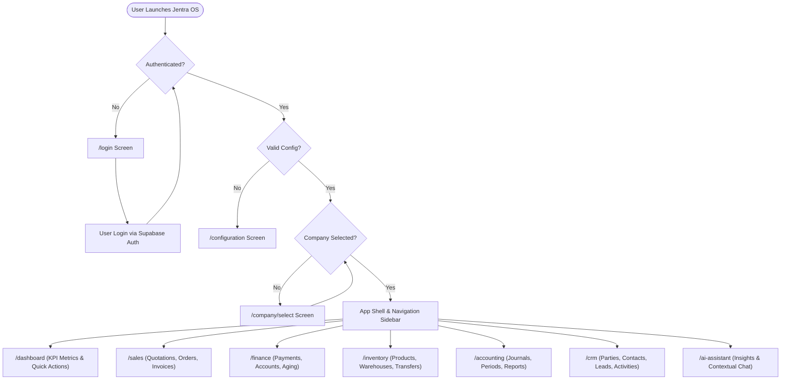
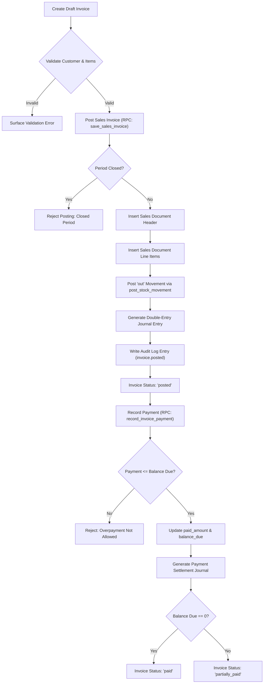
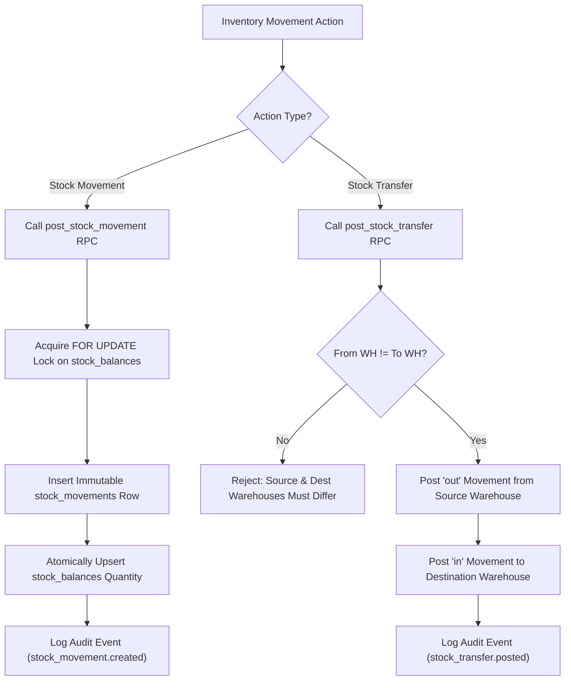
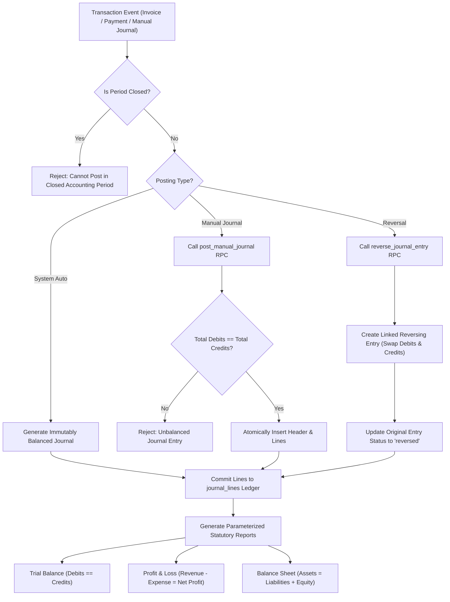

# Product Requirements Document (PRD): Jentra OS

**Version:** 1.0.0  
**Status:** Authoritative Baseline / Source of Truth  
**Target Platform:** SaaS Multi-Tenant Platform (Flutter Mobile/Web + Supabase PostgreSQL & Edge Functions)  

---

## Executive Overview & System Diagrams

### System Architecture Diagram

---

### User Flow Diagram

---

### Invoice Workflow Diagram

---

### Inventory Workflow Diagram

---

### Accounting Workflow Diagram

---

## 1. Product Vision

Jentra OS is an AI-powered Business Operating System engineered for Small and Medium Enterprises (SMEs). It unifies core business operations—Sales CRM, Finance, Purchasing, Inventory, Multi-Entry General Ledger Accounting, Subscriptions, and Business Intelligence—into a single, secure multi-tenant platform. Jentra OS bridges the operational gap between frontline sales and back-office statutory accounting through real-time double-entry automation and trusted server-side execution.

---

## 2. Mission

To empower growing enterprises with enterprise-grade operational rigor, real-time financial correctness, automated inventory accounting, and actionable AI-driven intelligence, eliminating manual reconciliations and fragmented business software.

---

## 3. Target Users

- **Small & Medium Enterprises (SMEs):** Trading companies, wholesale distributors, retail chains, and service businesses requiring multi-location operations.
- **Finance Directors & Accountants:** Business leaders who demand strict auditability, immutable financial ledgers, and zero-reconciliation overhead.
- **Operations & Warehouse Managers:** Logistics teams requiring precise stock movements, multi-warehouse transfers, and real-time inventory valuations.
- **Sales Reps & Account Managers:** Commercial teams handling quotes, customer pipelines, leads, and receivables collections.

---

## 4. Business Goals

- **Single Source of Truth:** Unify operational sales, inventory movements, and financial ledgers without external sync plugins.
- **Financial Correctness First:** Enforce zero-tolerance server-side double-entry accounting invariants over delivery speed.
- **Multi-Tenant SaaS Scalability:** Deliver strict isolation across companies and branches on a subscription model.
- **AI-Assisted Efficiency:** Provide evidence-backed, context-aware business insights with strict tenant data security.

---

## 5. Core Principles

1. **Server-Side Source of Truth:** All monetary balances, inventory quantities, and journal postings are calculated and mutated by trusted server functions (PostgreSQL RPCs or Edge Functions). Clients never calculate or mutate critical balances directly.
2. **Tenant Isolation by Construction:** Every business table is scoped by `company_id`. Row Level Security (RLS) is the final authorization boundary.
3. **Immutable Ledgers & Reversal History:** Posted invoices, stock movements, and journal entries are immutable. Errors are corrected via reversing entries and credit notes.
4. **Fail-Closed Configuration & Entitlements:** Misconfigured environments or expired subscriptions immediately drop to safe, restricted states without exposing data or unhandled exceptions.
5. **No Code Generation Invariants:** Models and serializers are hand-crafted for complete control, safety, and transparent debugging.

---

## 6. User Types

| User Role | System Scope | Primary Capabilities |
| --- | --- | --- |
| **Owner / Super Admin** | Full Company Scope | Billing, Subscription management, Role assignment, Company settings. |
| **Company Admin** | Selected Company | Branch creation, User membership management, Period locking, Master data. |
| **Finance Manager** | Financial & Accounting | Manual journal posting, Journal reversal, Statutory reports, Payment recording. |
| **Sales Manager** | Commercial Modules | Customer directory, Quotations, Sales Orders, Invoices, Receivables aging. |
| **Inventory Manager** | Warehouse & Stock | Product catalog, Stock balances, Stock transfers, Warehouse management. |
| **Standard Employee** | Assigned Scope | Read-only access or operational entry (e.g., draft sales quotes). |

---

## 7. Permission Model

Permissions are string tokens evaluated at both UI and database layers (e.g., `sales.write`, `finance.write`, `inventory.write`, `crm.write`).
- **UI Level:** Affordance hiding (disabling buttons/tabs).
- **Database Level (RLS / RPC):** Enforced via `private.has_permission(p_company_id, p_permission)`. Un-credentialed attempts raise PostgreSQL `42501` exception.

---

## 8. Multi-Company Architecture

- Every user profile can belong to multiple companies via `public.company_memberships`.
- Active operational scope is explicitly passed as `companyId` parameter to repositories and RPC calls.
- Repositories never read active company from mutable global state; scope is enforced via `CompanyContextGate` UI boundary.

---

## 9. Multi-Branch Architecture

- Companies contain multiple operational branches (`public.branches`).
- Users are assigned branch memberships (`public.company_member_branches`).
- Transactions and stock balances support branch-level filtering while consolidating into company-wide statutory general ledgers.

---

## 10. Subscription Model

| Plan | Price (Cents) | Max Members | Max Invoices/Mo | Intended Audience |
| --- | --- | --- | --- | --- |
| **Starter** | $29.00 ($2900) | 3 | 50 | Micro-businesses & startups |
| **Growth** | $79.00 ($7900) | 10 | 500 | Growing SMEs & multi-location stores |
| **Enterprise** | $199.00 ($19900) | 100 | 5,000 | Established trading enterprises |

**Entitlement Lifecycle States:** `trialing` (14 days default), `active`, `past_due`, `canceled`, `expired`.  
**Fail-Closed Rule:** Expired or canceled subscriptions reject write RPCs via `private.check_subscription_entitlement`.

---

## 11. Feature Modules

1. **Core / Company Management:** Multi-company context, membership management, roles, and branch assignment.
2. **Sales & Billing:** Customer catalog, Quotations, Sales Orders, Sales Invoices, Taxes, and Document Conversions.
3. **Finance & Banking:** Money Accounts (Cash/Bank), Payment Receipts, Outgoing Payments, Allocations, and Receivables/Payables Aging.
4. **Inventory & Warehouse:** Products, Categories, Stock Balances, Stock Movements, Multi-Warehouse Transfers, and Stock Adjustments.
5. **Accounting & General Ledger:** Chart of Accounts, Journal Entries, Manual Journal Editor, Journal Reversals, Accounting Periods, and Reports (Trial Balance, P&L, Balance Sheet).
6. **CRM & Lead Management:** Customer/Supplier Parties, Contact Directory, Multi-Address Records, Leads Pipeline, Lead Conversion, and Scheduled Activities.
7. **AI Assistant & Intelligence:** Evidence-backed context chat, real-time business context summary, prompt-injection defense, and insights inbox.
8. **Subscriptions & Entitlements:** Plan limits, status monitoring, and server-side entitlement checks.

---

## 12. Business Workflows

- **Lead-to-Cash Workflow:**  
  `Lead Created` → `Lead Converted to Party (Customer)` → `Quotation Issued` → `Sales Order Confirmed` → `Sales Invoice Posted` → `Payment Recorded` → `General Ledger Reconciled`.
- **Procurement & Stock Transfer Workflow:**  
  `Product Registered` → `Stock Inbound at Warehouse A` → `Stock Transfer to Warehouse B (RPC: post_stock_transfer)` → `Stock Balances Atomically Updated`.

---

## 13. Accounting Philosophy

- **Double-Entry Invariant:** Every financial transaction creates balanced debits and credits ($\sum \text{Debits} = \sum \text{Credits}$).
- **Automated Posting:** Invoice posting automatically debits Accounts Receivable and credits Sales Revenue. Payment recording debits Cash/Bank and credits Accounts Receivable.
- **Period Locking:** Closed accounting periods (`public.accounting_periods.is_closed = true`) block any back-dated postings or reversals.

---

## 14. Inventory Philosophy

- **Perpetual Inventory System:** Stock balances are updated in real-time upon posting sales invoices, transfers, or adjustments.
- **Immutable Movement Ledger:** `public.stock_balances` is never directly inserted or updated by clients. Every balance change is backed by an immutable row in `public.stock_movements`.
- **Atomic Balance Lock:** Server functions acquire row locks (`FOR UPDATE`) on balance rows during posting to prevent race conditions.

---

## 15. CRM Philosophy

- **Unified Party Model:** Parties (`public.parties`) act as customers, suppliers, or hybrid entities.
- **Atomic Lead Conversion:** Lead records convert to Party and Primary Contact records in a single database transaction via `convert_lead_to_party` RPC.

---

## 16. AI Assistant Philosophy

- **Evidence-Backed Responses:** Assistant replies cite real data sources (`get_company_business_summary`) and timestamp freshness.
- **Security First:** AI provider credentials live exclusively in Edge Function secrets. Prompts are sanitized against prompt-injection attacks (`AiPermissionGuard`).
- **Read-Only Default:** The assistant operates in a read-only mode to prevent unintended data mutations.

---

## 17. Security Requirements

- **Tenant Isolation:** Enforced via composite foreign keys and PostgreSQL Row Level Security.
- **Secret Hygiene:** No secret keys (`service_role`, `sb_secret_*`, AI provider keys) in Flutter code or committed files.
- **Sanitization:** Input inputs are sanitized against SQL injection and prompt injection.

---

## 18. Performance Requirements

- **Page Load Speed:** Dashboard and business lists load under 1.5 seconds.
- **Database Indexing:** Composite indexes on `(company_id, id)`, `(company_id, created_at)`, and `(company_id, status)`.
- **Pagination:** Cursor-based pagination (`pageSize = 30`) on all heavy lists.

---

## 19. Offline Requirements

- **Graceful Error Recovery:** Network failures surface clear, user-safe error messages (`AppDataException`) without crashing state providers.
- **Fail-Closed Operations:** Client does not queue un-verified local mutations for critical accounting state.

---

## 20. Mobile Requirements

- Responsive mobile navigation drawer and touch-optimized form inputs.
- Minimum tap target height of 48px for form controls.

---

## 21. Web Requirements

- Adaptive side navigation rail for desktop viewports.
- Keyboard shortcuts for data tables and dialog dismissals.
- Browser URL deep linking managed via `go_router`.

---

## 22. Reporting Requirements

- **Trial Balance:** Parameterized by `as_of_date`. Verifies $\text{Debits} = \text{Credits}$.
- **Profit & Loss:** Parameterized by `start_date` and `end_date`. Calculates Net Profit ($\text{Revenue} - \text{Expenses}$).
- **Balance Sheet:** Parameterized by `as_of_date`. Verifies $\text{Assets} = \text{Liabilities} + \text{Equity}$.
- **Receivables Aging:** Buckets uncollected invoice balances into Current, 1-30, 31-60, 61-90, and 90+ days.

---

## 23. Notification System

- In-app snackbars for user actions (success/failure feedback).
- Insights inbox for automated business opportunities and warning alerts.

---

## 24. Audit Logging

- Table: `public.audit_logs`.
- Recorded Events: `invoice.posted`, `payment.recorded`, `stock_movement.created`, `stock_transfer.posted`, `manual_journal.posted`, `journal.reversed`, `lead.converted`.
- Direct client writes (`INSERT`, `UPDATE`, `DELETE`) are revoked from `authenticated`.

---

## 25. File Management

- Table: `public.attachments`.
- Storage Buckets: Private, company-prefixed storage paths (`/company_id/entity_type/filename`).

---

## 26. API Standards

- PostgreSQL RPCs follow consistent parameter naming (`p_company_id`, `p_date`, etc.).
- RPC responses return structured JSON objects containing `success: true` and entity identifiers.

---

## 27. Coding Standards

- **Dart SDK:** `^3.12.2`, Flutter Riverpod `^3.3.2`, GoRouter `^17.3.0`.
- **Layering:** Feature-first clean architecture (`application`, `domain`, `data`, `presentation`).
- **No Codegen:** No `build_runner` or `freezed`; hand-crafted immutable models.

---

## 28. UI/UX Standards

- Modern dark/light theme options using Material 3 design system.
- Zero raw postgREST error displays; all errors mapped to user-safe failure types.

---

## 29. Error Handling Standards

- Sealed exception hierarchy (`AppException` -> `AppConfigurationException`, `AppDataException`).
- Sealed result type (`Result<T>` -> `Success<T>`, `Failure<T>`).

---

## 30. Future Roadmap

- **Phase 7 (Multi-Currency & Tax Engine):** Real-time exchange rate conversions and automated localized tax filings.
- **Phase 8 (Advanced Supply Chain):** Automated Purchase Orders, Goods Received Notes (GRN), and FIFO inventory costing valuation.
- **Phase 9 (AI Autopilot Actions):** Controlled AI-initiated draft invoice creation with human-in-the-loop confirmation.
