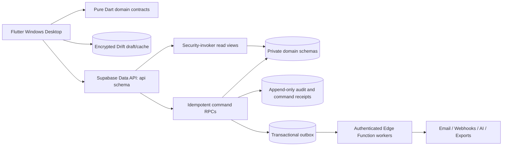

# Architecture and Decisions

## System topology



The system is a modular monolith. PostgreSQL provides strong transactions for business
documents, inventory, payroll, and accounting. Modules own their schema and public contracts;
they never reach across another module's private tables from the Flutter UI.

## Workspace boundaries

```text
apps/
  jentra_desktop/          Windows UI, routing, composition root
packages/
  jentra_design_system/    Semantic tokens and reusable desktop widgets
  jentra_domain/           Framework-free contracts and business primitives
  jentra_platform/         Supabase, secure storage, local drafts, connectivity
supabase/
  migrations/              Ordered immutable schema history
  functions/               Server-held integration and AI gateways
  tests/                   pgTAP security and transaction tests
docs/blueprint/             Approved implementation contracts
```

Feature code inside the desktop app follows `domain / application / infrastructure /
presentation`. Presentation imports application facades, never concrete storage clients.
`jentra_domain` has no Flutter or Supabase dependency. `jentra_platform` implements domain
ports and may depend on Flutter plugins.

## ADR-001: Windows-first Flutter

**Status:** Accepted  
**Decision:** Flutter 3.44.7 and Dart 3.12.2, Windows target only in Wave 1.  
**Rationale:** One strongly typed codebase supports a polished Windows application now and
later reuse on mobile without adopting a browser shell.  
**Consequences:** Windows-specific secure storage, window behavior, OAuth callbacks, signing,
and installer QA remain explicit platform work.

## ADR-002: Modular monolith

**Status:** Accepted  
**Decision:** One application and one PostgreSQL database with schema-enforced module
boundaries.  
**Rationale:** Financial and inventory workflows require atomic cross-module posting, while
the initial team does not benefit from distributed transactions or microservice operations.  
**Extraction rule:** A module becomes a service only when independent scaling, deployment,
or regulatory isolation is demonstrated by production evidence.

## ADR-003: Command/query boundary

**Status:** Accepted  
**Decision:** Read through `security_invoker` views; write through versioned idempotent RPCs.  
**Rationale:** Server-side validation, authorization, audit, optimistic locking, and atomic
posting cannot depend on client discipline.  
**Consequence:** Simple writes require an explicit command, but every mutation has a stable
contract and test surface.

## ADR-004: Safe offline drafts

**Status:** Accepted  
**Decision:** Cache reference data and encrypted drafts locally. Never automatically enqueue
authoritative financial, inventory, payroll, payment, or approval posts while offline.  
**Rationale:** Silent conflict resolution is unacceptable for legally or financially material
state.  
**Conflict rule:** Stale versions produce a conflict object containing local and current
server versions; a user selects merge, replace draft, or discard.

## ADR-005: Authorization source of truth

**Status:** Accepted  
**Decision:** Membership, role, permission, scope, and entitlement tables are authoritative.
JWT data is only an authentication signal and optional coarse cache. `user_metadata` is never
authorization input.  
**Consequence:** RLS helper functions perform indexed membership checks and remain correct
after role changes without waiting for token refresh.

## ADR-006: Money and time

**Status:** Accepted  
**Decision:** ISO 4217 currency codes, database `numeric(20,6)`, decimal-backed Dart values,
UTC timestamps, and an explicit tenant/legal-entity time zone.  
**Consequence:** Binary floating point is forbidden for monetary calculations. Rounding is a
versioned legal-entity policy and creates explicit adjustment lines when required.

## Reliability and observability

- Correlation/request IDs travel from Flutter through RPCs, audit, outbox, and Edge Functions.
- Logs contain actor/tenant identifiers only where required and exclude secrets and raw PII.
- Workers use bounded exponential retry and a dead-letter state.
- Database constraints and idempotency are the final consistency boundary; Realtime is used
  for refresh notifications, not as transaction truth.
- Production targets are 99.9% availability, RPO at most one hour, and RTO at most four hours;
  the production Supabase plan must support those targets before launch.
