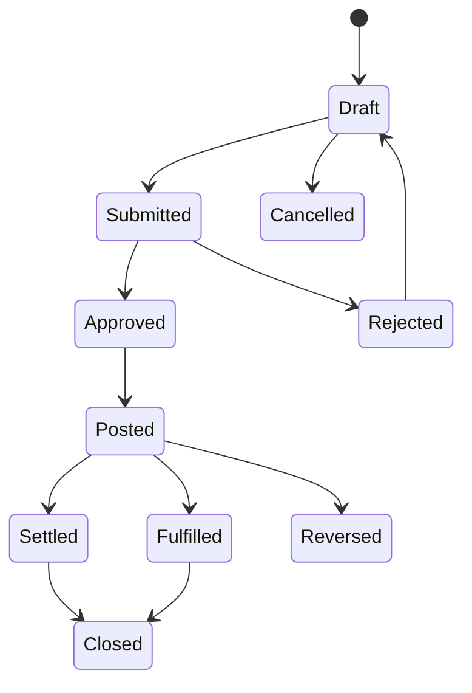

# Domain and Process Blueprint

## Tenant hierarchy

`Tenant / business group → Legal entity → Branch → Warehouse, cost centre, project`

- Tenant is the SaaS isolation and subscription boundary.
- Legal entity owns fiscal books, base currency, tax settings, and numbering rules.
- Branch is the operational location and default permission scope.
- Warehouse, cost centre, and project are optional scopes below a legal entity or branch.
- A user can hold different roles and scopes in multiple tenants.

## Module map

| Domain | Capabilities | Primary outcomes |
|---|---|---|
| Core | Identity, tenancy, branch, RBAC, entitlements, workflow, audit | Safe context and governance |
| CRM | Parties, contacts, leads, opportunities, activities | Qualified revenue pipeline |
| Sales | Quotes, orders, delivery, invoices, returns, receipts | Lead-to-cash |
| Procurement | Requisitions, approval, RFQ, PO, receipt, bill, return | Procure-to-pay |
| Inventory | Items, UOM, lots/serials, warehouses, movements, valuation | Perpetual stock truth |
| Finance | GL, AR/AP, cash/bank, tax, budgets, periods, reporting | Record-to-report |
| People | Employees, attendance, leave, payroll, performance | Hire-to-retire |
| Projects | Projects, tasks, time, expense, billing, margin | Project-to-cash |
| Service | Tickets, SLA, work orders, equipment, warranties, contracts | Service-to-resolution |
| Assets | Asset register, depreciation, maintenance, disposal | Controlled asset lifecycle |
| Analytics | KPIs, cycle time, ratios, variance, forecasts | Decision support |
| AI | Scoped search, explanation, drafts, proposals, approvals | Human-controlled assistance |
| Billing control | Plans, trials, seats, entitlements, metering | Jentra SaaS operations |

## Shared document lifecycle

- Drafts are mutable and versioned.
- Submission freezes material fields until rejection or recall.
- Approval applies configurable amount, department, and segregation-of-duty rules.
- Posting is a server transaction that creates operational, audit, and accounting effects.
- A posted record is never edited or deleted. Correction uses a linked reversal or adjustment.

## Canonical workflows

### Lead-to-cash

Lead → qualification → opportunity → quotation → approval → sales order → allocation →
delivery → invoice → receipt → bank reconciliation → close.

Posting rules connect delivery to inventory movement and invoice/receipt to balanced journal
entries. Sales pipeline analytics capture stage conversion, aging, coverage, velocity, and
forecast accuracy.

### Procure-to-pay

Requisition → approval → RFQ/selection → purchase order → goods receipt → supplier bill →
three-way match → payment approval → payment → bank reconciliation → close.

Tolerance exceptions route back through approval. Receipt creates inventory; supplier bill
and payment create AP and cash journal effects.

### Inventory-to-ledger

Receipt / issue / transfer / adjustment / return → immutable stock movement → lot/serial
tracking → weighted-average valuation → inventory/COGS or variance journal → reconciliation.

Stock is derived from movements, never edited as an isolated balance. Negative inventory is
disabled by default and requires a separately audited entity policy.

### Record-to-report

Source documents and approved manual journals → subledger reconciliation → bank
reconciliation → adjustment → period review → lock → P&L / balance sheet / cash flow → budget
variance and rolling forecast.

Closed periods reject new postings. Reopening a period is privileged and audited.

### Hire-to-retire

Employee onboarding → assignment → attendance/leave → approved earnings/deductions → payroll
calculation → review → payroll posting → payslip/export → offboarding and final settlement.

Sri Lankan statutory rules are effective-dated data and require qualified validation before
production use.

### Project-to-cash

Project setup → task/resource plan → time/expense capture → approval → milestone or T&M
billing → receipt → project margin and close.

### Service-to-resolution

Ticket → triage → SLA → assignment → work order → parts/time → customer confirmation →
service invoice/warranty allocation → resolution and feedback.

## Process telemetry

Every workflow transition records `workflow_instance_id`, stage, actor, owner, entered time,
completed time, active-work minutes, wait minutes, rework flag, reason, and correlation ID.
Analytics can then calculate P50/P90 duration, value-add ratio, handoff waits, rework rate, and
throughput without inferring process history from mutable status columns.
