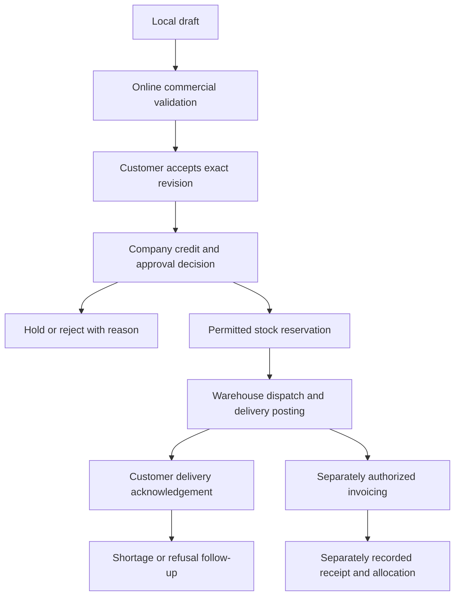

# Jentra Sales — salesman app blueprint

**Author:** Codex  
**Date:** 2026-10-08 (Asia/Colombo)  
**Status:** Draft for review; proposed Android/iPhone field-sales app.  
**Reviewers:** Product owner, sales manager, finance owner, warehouse owner, engineering and design.  
**Dependencies:** [Shared foundation](SHARED_MOBILE_FOUNDATION.md), reviewed commerce/credit/stock contracts and [mobile design brief](MOBILE_DESIGN_BRIEF.md).

## Context

A salesman needs assigned customers, product and price information, quick quotations/orders, reliable confirmation and visibility into delivery and outstanding invoices while visiting customers. Jentra already has quotation/order lifecycles, exact amounts, credit evaluation, reservations, delivery, invoices and receivables. Reuse those authoritative business facts rather than creating a second sales ledger in the phone.

The current repository's salesperson/owner fields provide attribution, not assigned-customer authorization. Broad CRM/customer/order/receivable capabilities can expose an entire permitted tenant/branch. A narrow phone screen or new facade is insufficient while those legacy paths remain callable. Dated portfolio authorization and enforced restrictions across all public paths are prerequisites.

The owner confirmed **customer acceptance, company approval and delivery acknowledgement** on October 8. Existing quotation accept and order confirm actions are internal actor actions without a dedicated verified customer-evidence contract. Governed price books/discount limits, visit planning, customer confirmation and collections custody also require new work. The [October 6 recorded status](../../development/remaining-wave3-status.md) does not establish these new mobile contracts or real-device readiness.

## Users and authority

| User | Responsibility | Default limits |
|---|---|---|
| Salesman / sales representative | Assigned customer visits, quotation/order preparation, request acceptance, follow-up and permitted delivery acknowledgement capture | No credit override, arbitrary price edit, stock posting, invoice/receipt posting or payroll access |
| Sales manager | Dated portfolios, discount exceptions and company approval within delegated scope | No bank reconciliation or stock posting merely through sales authority |
| Credit/finance officer | Credit hold/override under existing rules; invoices, receipts, allocations and reconciliation | Independent authority; not delegated automatically to the salesman |
| Warehouse/dispatch user | Stock reservation when permitted, picking, delivery posting, dispatch and shortages | Customer acknowledgement does not substitute warehouse control |
| Customer contact / recipient | Accept/reject specific commercial terms; acknowledge actual received quantities | Minimal verification flow, no employee or internal Jentra membership required by default |

A salesman who also has legitimate manager authority must select the correct task/context. Granting manager permission is a deliberate access change; installation, salesperson attribution and local app preferences never grant it.

## Screens and navigation

Phone navigation: **Today · Customers · Orders · More**. New order is a primary action within Today, Customer and Orders; customer selection remains explicit. Catalogue, quotations, visits, deliveries and inbox are contextual destinations. Pipeline/follow-up remains available where CRM facts exist.

| Screen | Purpose / primary action |
|---|---|
| Today | Due visits/tasks, pending customer/company confirmations, returned orders and real delivery exceptions |
| Customers | Search assigned portfolio including customers with no open order; select customer/context |
| Customer detail | Contacts, permitted address/terms, scoped order history, invoice/outstanding summary and next action |
| Visit | Planned purpose, optional at-tap evidence, notes/outcome and follow-up; one tap starts a customer order |
| Catalogue | Authorized saleable products, units, prices, stock freshness and product search; barcode entry is optional S2 |
| New quotation/order | Customer, lines, unit/quantity, governed price, permitted discount, terms and delivery request |
| Review before submit | Full exact totals, tax/rounding, source revisions, credit result and stock advisory; submit online |
| Confirmation detail | Three separate customer/company/delivery panels with actors, revisions, timestamps and next action |
| Order timeline | Saved/submitted, customer response, company credit/approval, reservation, dispatch, delivery, invoice and payment facts |
| Delivery detail | Specific posted delivery, actual quantities, recipient evidence, shortages/refusals and follow-up |
| Customer follow-up | Customer requests, CRM tasks/opportunities and invoice reminders within portfolio scope |
| Collections — S2 | Evidence submission, custody/handover, finance decision and receipt/allocation state |
| More | Draft recovery, language/theme, permitted reports, account/devices, help and S2 destinations |

Today only shows sourced tasks/events; do not invent urgency, quota, ranking or target achievement. Customer search must include the full assigned portfolio, not only customers with opportunities.

## Functional Requirements

- FR-7201: The app MUST resolve current dated salesman/customer/entity/branch/territory assignments and enforce them for every read, detail, command, file, export and legacy route.
- FR-7202: Today MUST surface real assigned visits, follow-ups and pending confirmation/fulfilment exceptions, without invented quota, priority scores or revenue.
- FR-7203: Customer detail MUST expose only authorized contacts, delivery/credit terms, transaction history and receivable summary; portfolio reassignment MUST invalidate prior app access.
- FR-7204: Visit planning/notes MUST record authorized customer, purpose, actor, outcome and next action; location MUST be optional at a declared visit action, with no continuous tracking.
- FR-7205: Catalogue MUST show permitted product/unit/warehouse and price/availability freshness; displayed stock MUST distinguish on-hand, allocated and available quantities when that provider exists.
- FR-7206: Selling prices, discount ceilings, tax basis, currency and FX evidence MUST be governed by dated server policy; exact arithmetic alone MUST NOT authorize an arbitrary user-entered price.
- FR-7207: Quotation preparation MUST retain versioned lines, terms, validity, salesperson attribution and history, with explicit conversion to an order and no duplicate conversion on retry.
- FR-7208: Order entry MUST support exact units/quantities, customer reference, requested delivery address/date, permitted discounts and complete line/document totals, using existing server calculations.
- FR-7209: Submission MUST revalidate assignment, customer status, price/rule versions, tax/FX/credit and product/warehouse state online, presenting material changes for explicit review rather than silent repricing.
- FR-7210: Customer acceptance MUST bind an authorized customer contact, accept/reject response, verified method and exact commercial revision/digest/expiry; a salesman MUST NOT record themselves as verified customer acceptance.
- FR-7211: Material changes to product, unit, quantity, price, discount, tax, currency, payment or delivery terms MUST supersede prior acceptance and trigger re-acceptance when required by the order policy.
- FR-7212: Company approval MUST recheck current credit and commercial source under existing rules; credit hold/override MUST require separate authority and MFA, preserving actor/reason/history.
- FR-7213: Stock reservation MUST occur only through current authoritative permissions and source versions; shortfall/expiry/partial allocation MUST remain visible and MUST NOT be described as delivery.
- FR-7214: Order tracking MUST preserve distinct customer response, company decision, reservation, dispatch, delivery, invoice and settlement facts with current source IDs and timestamps.
- FR-7215: Delivery acknowledgement MUST bind a specific delivery/version, verified recipient, exact received/refused/short quantities and evidence, including partial deliveries; acknowledgement MUST NOT itself post stock or an invoice.
- FR-7216: Delivery exceptions and order cancellation/change requests MUST route to the responsible warehouse/sales owner with immutable history; posted stock/invoices MUST use governed corrections rather than deletion.
- FR-7217: Authorized invoice/outstanding views MUST distinguish issued invoices, posted receipts, allocated amounts and reconciliation; transfer screenshots or a promised payment MUST NOT display as cleared funds.
- FR-7218: Follow-up MUST support scoped CRM tasks/opportunities and user-triggered sharing of authorized frozen offers or confirmation requests; no automatic external outreach is enabled by this blueprint.
- FR-7219: Offline order/quote/visit drafts MUST remain encrypted and visibly local, with explicit online review, original command recovery and no implied credit approval or reserved stock.
- FR-7220: S2 collection submission MUST retain method, exact amount/currency, customer/invoice references, evidence and custody state; finance-authorized receipt posting/allocation and cash/cheque handover MUST remain distinct.
- FR-7221: S2 return requests MUST reference original authorized delivery/invoice quantities and route to governed return approval/posting; a return request MUST NOT automatically issue a refund or stock adjustment.
- FR-7222: The inbox MUST deliver current assigned-subject confirmation, credit hold, dispatch, exception and follow-up events without disclosing customer terms or amounts in push payloads.
- FR-7223: Sales measures MUST state scope, period, currency, authoritative fact and reversal treatment; customer acceptance/orders MUST NOT be counted as posted invoice revenue or cleared cash.
- FR-7224: The app MUST disable actions whose price, confirmation, stock, finance or notification providers are unavailable and expose a useful next step without substitute/fabricated success.

## All three confirmations



This is the proposed normal sequence, not a replacement for existing document states. An approved order policy may allow company pre-review before customer acceptance; required acceptance still binds the final terms, and final progression must satisfy both controls. Customer acceptance never bypasses credit hold.

| Fact | Who establishes it | Meaning and invalidation |
|---|---|---|
| Customer acceptance | Verified authorized customer contact, via a minimal scoped flow | Accepts frozen commercial terms; material revision or expiry prevents reuse |
| Company approval | Current delegated Jentra approver/credit owner | Allows progression under current rules; source/version/credit changes require revalidation |
| Delivery acknowledgement | Verified recipient for the specific delivery | Records received/refused/short quantities; discrepancy is retained and routed for decision |

Customer interaction requires a small proposed secure web confirmation surface accessible from an authorized link or customer-held verification flow. It is not a third full customer app. A link alone is not identity proof: tokens must be scoped, short-lived, revocable, replay-safe and bound to a separately verified contact/channel or authenticated customer identity. The contact sees only the frozen offer/delivery minimum and may accept/reject or report discrepancy. A typed signature/photo alone is **witnessed evidence**, not verified customer identity.

Proposed verification challenge lifetime: 15 minutes; commercial acceptance expires with the offer/order policy, not merely with the challenge. Token/OTP rate limits, customer representative authority and channel choice require review before release. Do not put bearer tokens, OTPs, sensitive customer details or prices in telemetry. Changed contact, revoked link or already-used challenge cannot create another acceptance.

For partial delivery, each posted delivery gets its own acknowledgement. Accepted quantities cannot exceed that delivery's dispatched quantities; refused/short quantities are explicit. The original posted record remains intact. Warehouse/finance decide linked corrections and billing treatment. Declining a delivery does not reverse stock or an invoice automatically.

## Operational walkthrough and owners

| Step | Owner | Input → action → result | Check / exception |
|---|---|---|---|
| Prepare | Salesman | Assigned customer + catalogue → enter lines/terms → local draft | Offline label and stale-price indicator |
| Validate | Server + salesman | Draft → current price/tax/credit preview → reviewed server revision | Material change needs explicit review |
| Obtain acceptance | Customer | Frozen revision → verified accept/reject → attributable response | Expired/revised terms stay unaccepted |
| Decide company progression | Sales/credit owner | Accepted order → approved/held/rejected decision | Separate authority and credit override history |
| Fulfil | Warehouse/dispatch | Authorized order → reservation/picking/posted delivery | Shortfall/expiry needs explicit owner action |
| Acknowledge | Customer recipient | Specific delivery → received/refused quantities → evidence | Discrepancy cannot silently change stock |
| Invoice and collect | Finance; salesman only in approved S2 | Posted source → invoice; collection evidence → receipt/allocation/handover | Evidence is not cleared or reconciled money |

## Non-Functional Requirements

Shared NFR-7001–7009 apply; these additional targets are proposed.

- NFR-7201: Assignment tests MUST cover list/detail/search/aggregate/files/export/receipt and legacy endpoints with zero cross-portfolio leakage, including customers without open orders.
- NFR-7202: A 100-line order MUST complete local editing/review without loss at 360 logical-px width; online server preview MUST meet the shared read target on the documented fixture.
- NFR-7203: Twenty simultaneous retries/conversions/reservations MUST produce at most one authorized business effect per key and no quantity above available authority.
- NFR-7204: Verification MUST limit challenges to at most 5 failed attempts per challenge and 5 new challenges per recipient per hour by default; requests MUST have abuse-rate controls and no valid-contact enumeration.
- NFR-7205: Delivery evidence MUST allow at most 5 attachments of 10 MiB each, with validated PDF/JPEG/PNG type, digest and private storage; signatures/location require reviewed purpose and retention.
- NFR-7206: Required S1 tasks MUST work in all three languages, themes, screen-reader modes and 200% text on physical Android/iPhone devices; exact line amounts MUST remain readable.

## Acceptance Criteria

### AC-7201: Portfolio authorization (FR-7201, FR-7203; NFR-7201)

Given two assigned salesman portfolios, when a rep searches, requests a detail/file/aggregate or directly invokes legacy APIs for another portfolio, then protected data/effects are denied; all own assigned customers remain searchable even without opportunities.

### AC-7202: Daily field work (FR-7202, FR-7204, FR-7218, FR-7222)

Given real assigned visits/tasks and a due confirmation, when Today opens and a visit/follow-up is recorded, then sourced actions persist in the correct customer context and notification denial does not block the authenticated inbox.

### AC-7203: Governed exact selling (FR-7205, FR-7206, FR-7208; NFR-7202)

Given price policy, exact unit quantities and a permitted discount, when a 100-line draft is previewed, then server totals/tax/rounding match the policy; an arbitrary price or excessive discount is denied or routed to authorized exception approval.

### AC-7204: Quote conversion and changed source (FR-7207, FR-7209, FR-7219; NFR-7203)

Given an offline quotation and changed prices/assignment, when it reconnects and conversion is retried, then the user reviews current material differences, revoked assignment blocks submission and one authorized conversion produces one order.

### AC-7205: Customer identity and terms (FR-7210, FR-7211; NFR-7204)

Given a verified authorized contact and frozen order revision, when the customer accepts and a price later changes, then acceptance remains attached to the original revision and the changed offer requires new acceptance; a rep, copied/expired token or excessive failed challenge cannot impersonate the customer.

### AC-7206: Company approval and stock (FR-7212, FR-7213; NFR-7203)

Given an accepted order with insufficient credit or stock, when company progression is requested, then the credit hold and allocation shortfall remain explicit; only a permitted independent decision/override and valid reservation can advance the affected state.

### AC-7207: Delivery acknowledgement (FR-7214, FR-7215; NFR-7205)

Given two partial deliveries, when recipients acknowledge received/refused quantities, then each response binds its own delivery/version, cannot exceed dispatched quantities and does not post stock or invoices.

### AC-7208: Exceptions and finance truth (FR-7216, FR-7217)

Given an acknowledged shortage and a transfer screenshot, when the order timeline refreshes, then the shortage is routed with original history preserved and payment remains evidence/pending until separately authorized receipt/allocation/reconciliation facts exist.

### AC-7209: Collections and returns extensions (FR-7220, FR-7221)

Given approved S2 permissions and a collection/return request, when it is submitted, then evidence/custody and return status remain separate from receipt/refund/stock posting, duplicate keys have one effect and unauthorized finance actions are denied.

### AC-7210: Measures and provider failure (FR-7223, FR-7224)

Given mixed currencies, a reversed invoice and an unavailable stock provider, when reports and order actions open, then totals are grouped by authoritative currency/fact, reversed amounts are treated explicitly and stock-dependent actions do not report invented availability or success.

### AC-7211: Usable phone orders (FR-7208, FR-7214, FR-7222; NFR-7206)

Given each supported phone/language/theme at 200% text with screen reader, when a rep edits/submits an order and follows confirmations, then amounts, errors, states and required actions remain readable and correctly announced.

## Edge Cases

- EC-7201: Customer is reassigned/deactivated after local capture — deny old-portfolio submission and offer authorized manager reassignment; original salesperson attribution is retained as historical evidence.
- EC-7202: Price book, discount/tax/FX rule or terms change after acceptance — require new commercial revision and re-acceptance; no silent substitution under an old digest.
- EC-7203: Credit preview passes but another order raises exposure before confirmation — current locked confirmation may hold/reject; cached preview is not approval.
- EC-7204: Stock reservation expires or another valid command consumes availability — refresh shortfall; never show local draft as reserved or delivered.
- EC-7205: Customer channel fails, wrong contact is challenged or token is replayed — retain pending/rejected evidence and verification failure; no rep override of customer identity.
- EC-7206: Customer rejects after company pre-review — no final progression where acceptance is required; retain both independent decisions and cancellation follow-up.
- EC-7207: Recipient differs from purchaser, partial receipt or damaged goods — verify permitted delivery-recipient authority and record exact exception quantities; warehouse/finance resolve treatment.
- EC-7208: Finance period closes after a collection request — submission remains evidence; finance posting follows open-period rules and cannot backdate around a closed period.
- EC-7209: Network fails after order save/conversion/confirmation — reconcile original immutable command envelope; do not create a duplicate order or verified response.
- EC-7210: Customer transfers money twice or cheque is later dishonoured — finance deduplicates evidence and applies governed corrections; collection evidence alone does not settle an invoice.
- EC-7211: Visit/location evidence is absent or camera/upload fails — manual permitted visit note/exception remains available; invalid evidence never appears uploaded.
- EC-7212: Catalogue, receipt or stock provider is missing — explain the actionable blocked step and preserve draft; do not fall back to arbitrary prices or fabricated balances.

## API Contracts

| Existing interface / contract | Reuse | Limitation requiring new work |
|---|---|---|
| CRM commands `upsert_lead`, `record_crm_activity`, `upsert_opportunity`, `convert_lead` | CRM facts and activity lineage | Owner fields do not enforce field-sales assignment |
| Quotation views/commands and `convert_quotation_to_order` | Exact lines, totals, revision, workflow and conversion | Internal `accept` is not verified customer acceptance |
| `upsert_sales_order`, `transition_operational_document` | Order draft and company lifecycle | `document_type=sales_order, action=confirm` uses broad `sales.orders.manage`; no existing `sales.confirm_order` endpoint |
| Credit evaluation and hold/override decisions | Current customer/currency/exposure checks | Rep must not gain override authority |
| `reserve_sales_order_stock` | Versioned warehouse allocation and shortfall | Permission and assignment gate; not physical stock issue |
| `post_delivery`, `post_sales_invoice`, `post_sales_return` | Existing authoritative stock/accounting | Separate warehouse/finance actors; delivery acknowledgement is new |
| Receipt preparation/post/allocation and customer statement/aging | Accounting truth and permitted read projections | Rep evidence/custody/handover requires new contracts |

Source evidence: [order workspace/credit/reservation](../../../supabase/migrations/20260907044241_complete_sales_order_workspace.sql), [quotation workflow](../../../supabase/migrations/20260906153036_complete_quotation_workspace_contracts.sql), [delivery/receivables](../../../supabase/migrations/20260910135010_complete_delivery_receivables.sql) and [lead-to-cash gateway](../../../packages/jentra_platform/lib/src/supabase_lead_to_cash_gateway.dart). Validate actual installed signatures before implementation.

Proposed capabilities: `sales.field.customers.view`, `sales.field.catalogue.view`, `sales.field.quotations.manage`, `sales.field.orders.submit`, `sales.customer_confirmation.request`, `sales.delivery_acknowledgement.capture`, `sales.field.receivables.view`, `sales.field.visits.manage`; S2 `sales.collections.submit` and `sales.returns.request`. Company/credit approval retains separately scoped existing or reviewed new authority. Field roles must not inherit broad legacy `crm.parties.view`, `sales.orders.manage` or `finance.receivables.view` without server-enforced portfolio restrictions.

Use shared types from [the foundation](SHARED_MOBILE_FOUNDATION.md). The server derives actor/rep scope; customer/contact IDs are validated selectors.

```typescript
interface CommercialLine {
  productId: string; unitId: string; quantity: Decimal;
  pricePolicyVersion: string; requestedDiscount: Decimal | null;
}
interface FieldOrderInput {
  customerId: string; warehouseId: string; currency: string;
  lines: CommercialLine[]; requestedDeliveryDate: string;
  deliveryAddressId: string; paymentTermsId: string; customerReference?: string;
}
interface ConfirmationInput {
  subjectId: string; revision: string; termsDigest: string;
  contactId: string; verifiedChallengeReference: string;
  response: "accept" | "reject";
}
interface DeliveryAcknowledgementInput {
  deliveryId: string; deliveryVersion: string; recipientId: string;
  challengeReference: string;
  lines: { deliveryLineId: string; received: Decimal; refused: Decimal; short: Decimal }[];
  reason?: string; evidenceIds: string[];
}
interface FieldSales {
  workspace(scope: Scope): Promise<Result<FieldWorkspace>>;
  customers(scope: Scope, query: string, cursor?: string): Promise<Result<Page<CustomerSummary>>>;
  catalogue(customerId: string, query: string, cursor?: string): Promise<Result<Page<SaleableProduct>>>;
  preview(input: FieldOrderInput): Promise<Result<CommercialPreview>>;
  submit(command: Command<FieldOrderInput>): Promise<Result<Receipt<FieldOrder>>>;
  requestAcceptance(command: Command<AcceptanceRequest>): Promise<Result<Receipt<ConfirmationChallenge>>>;
  acknowledgeDelivery(command: Command<DeliveryAcknowledgementInput>): Promise<Result<Receipt<DeliveryResponse>>>;
}
```

Proposed RPC transports: `POST /rest/v1/rpc/field_sales_workspace`, `field_sales_customers`, `field_sales_catalogue`, `field_sales_subject_page`, `field_sales_subject_detail`, `field_sales_preview`, `field_sales_command`, `field_sales_acceptance_request` and `field_sales_delivery_acknowledgement`. `field_sales_command` has separately validated quote_save/submit/convert, order_save/submit/change_request/cancel_request, visit_record, followup_record/share_request and S2 collection_submit/return_request intents; it cannot pass arbitrary generic actions. Server wrappers must not authenticate by trusting app-kind headers or user-supplied actor IDs.

Customer-side proposed HTTPS operations are `POST /mobile-confirmations/challenge` and `POST /mobile-confirmations/respond`, protected by contact verification, scoped tokens and rate limits rather than broad authenticated ERP access. The verified customer response is distinct from a rep requesting an acceptance link. SMS/email provider selection, abuse controls and consent require review before deployment.

`CommercialPreview` returns authoritative line/document totals, policy revisions/digest, currency, credit result and stock freshness. `FieldOrder` returns server ID/version and independent states. `FieldWorkspace` contains sourced tasks/visits and inbox references; `CustomerSummary` contains allowed portfolio details; `SaleableProduct` contains authorized product/unit/price and advisory stock; `AcceptanceRequest` identifies frozen subject/revision/contact; `ConfirmationChallenge` contains an opaque share reference and expiry; `DeliveryResponse` records versioned line quantities, verified recipient and exception status. Every result is redacted to current actor/subject scope. Add `PRICE_CHANGED`, `DISCOUNT_APPROVAL_REQUIRED`, `CREDIT_HOLD`, `STOCK_SHORTFALL`, `ACCEPTANCE_SUPERSEDED`, `CONTACT_NOT_AUTHORIZED`, `CHALLENGE_EXPIRED`, `RATE_LIMITED` and `DELIVERY_QUANTITY_INVALID` to common errors; material changes include current versions and affected fields.

## Data Models

| Entity | Fields / types | Constraints and owner |
|---|---|---|
| Field-sales assignment | rep/customer/entity/branch/territory IDs, effective dates, capabilities, version | New governed dated access; historical attribution is separate |
| Customer summary/contact | customer/contact IDs, permitted address/terms/statement refs, representative authority | Existing CRM plus new authorized-contact/portfolio projections |
| Saleable product/price policy | product/unit/warehouse IDs, currency, decimal price, rule version, dates, discount bound, tax/FX refs | New price policy over existing product/exact arithmetic; no arbitrary client price |
| Visit/follow-up | rep/customer IDs, planned/actual UTC, purpose, outcome, task refs, optional evidence | New scoped planning record; CRM adapter preserves activity lineage |
| Quotation/order | ID/version, customer/rep, exact lines/totals, terms, dates, rule refs | Existing business document; mobile limited to authorized intents |
| Commercial acceptance | subject/revision/digest, customer/contact, response, assurance/method, verified UTC, expiry, supersession | New immutable evidence; cannot transfer between revisions |
| Confirmation challenge | opaque ID/token digest, contact/subject/revision, channel, expiry, attempts/use/revoked state | New short-lived proof workflow; private, rate-limited, replay-safe |
| Company decision | order/version, decision/hold/override, actor, reason, UTC | Existing control extended through authorized mobile/admin facade |
| Reservation/delivery | order/line/warehouse/delivery IDs, decimal quantities, expiry/posted facts, versions | Existing stock truth; no mutation by customer response |
| Delivery acknowledgement | delivery/version/recipient, verified method/UTC, exact line responses, evidence, dispute refs | New immutable evidence per actual partial delivery |
| Exception/change request | original subject/version, type, reason, owner, decision/history | New request to existing correction/cancellation authority |
| Invoice/receipt/aging projection | source IDs, dates, currency, exact posted/allocated/outstanding amounts | Existing finance truth; narrow customer read is new |
| Collection/custody — S2 | customer/invoice/rep IDs, method, decimal amount/currency, evidence, custody/handover events, finance receipt refs | New custody chain; no implicit finance settlement |
| Return request — S2 | original delivery/invoice/line IDs, decimal quantities, reason/evidence, approval refs | New request over existing governed sales return |

Private inbox, draft/recovery and attachments reuse shared models. No commission ledger, predictive ranking or route optimizer is implied by these entities.

## Out of Scope

- OS-7201: Unrestricted CRM, credit overrides, arbitrary discounts, stock posting or accounting permissions for salesmen — controlled authority remains separate.
- OS-7202: Autonomous external messages, automatic offline order/stock/payment posting and customer impersonation — incompatible with explicit, attributable actions.
- OS-7203: Cash/cheque collections, handover and return-request implementation in S1 — S2 depends on separately approved custody/accounting contracts.
- OS-7204: Commission payroll, sales forecasting AI, route optimization and continuous GPS monitoring — separate product definitions and validated providers would be needed.
- OS-7205: A full customer shopping app, payment gateway or bank execution — the small confirmation surface serves only bounded acceptance/receipt evidence.

## Workflow walkthroughs and business measures

**Normal design walkthrough:** Salesman visits an assigned customer, creates an order at the governed price, submits online, obtains verified acceptance of that exact revision, and follows company approval and stock allocation. Warehouse posts a partial delivery. Its authorized recipient acknowledges exact received quantities. Finance issues the invoice through its own authority; the salesman views the permitted outstanding balance.

**Exception design walkthrough:** A draft is captured offline. A price changes before submission; the salesman must review the updated offer and obtain new acceptance. Credit has also changed, so company confirmation places a hold. An uncertain network reply is resolved through the original command receipt. No duplicate order, reserved stock or delivery promise is invented.

Measure order-entry completion time, orders returned for correction, company decision age, customer acceptance age, delivery discrepancies and conversion from approved orders to posted invoices. Order value, invoice revenue and receipts have separate definitions; currency groups and reversals are explicit. Quotas/targets and commission measures appear only after governed data and rules exist. No current performance or revenue gain is claimed.
