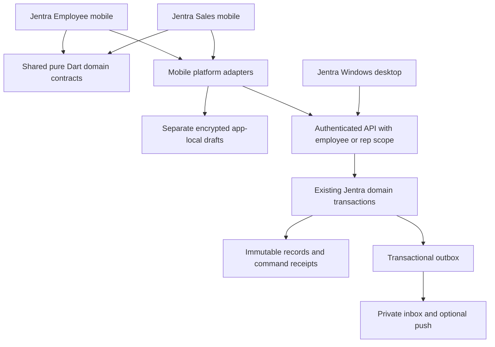

# Shared mobile foundation specification

**Author:** Codex  
**Date:** 2026-10-08  
**Status:** Draft; all mobile interfaces below are proposed unless explicitly marked existing.  
**Reviewers:** Product owner, engineering, security, design and operations.

## Context

Jentra already separates framework-free business contracts, platform adapters and presentation. The employee and salesman apps should reuse that separation and the same authoritative PostgreSQL business transactions. Copying payroll or order rules into new phone applications would produce inconsistent results and duplicate correction logic.

The accepted [architecture](../01_ARCHITECTURE.md) permits encrypted offline drafts but prohibits automatic authoritative offline posting. Current desktop platform code also has Windows-specific assumptions. Sharing a package name does not prove Android/iPhone support: storage, file export, callback, push, camera and location adapters need explicit mobile implementation and physical-device tests.

## Proposed architecture and module seams



Proposed future paths: `apps/jentra_employee`, `apps/jentra_sales`, and a narrowly scoped `packages/jentra_mobile_platform`. Reuse `jentra_domain` and semantic tokens from `jentra_design_system`. Add mobile widgets within the design package only when they are reusable. Keep Windows behavior behind its existing adapters. Do not extract a second payroll/order database or deploy a microservice merely to serve mobile.

The deep modules are **Mobile identity**, **Safe draft/command recovery**, **Employee self-service**, **Assigned field sales**, **Confirmation evidence** and **Private inbox**. Their interfaces expose business intents, typed results and errors. Storage, retries, auth refresh and receipt handling stay inside the relevant implementations. Real mobile/backend and deterministic test adapters cross the same interfaces; no screen calls private tables directly.

## Functional Requirements

- FR-7001: Both apps MUST authenticate through Jentra's existing identity provider and resolve active membership, scope, permissions and entitlements from the server.
- FR-7002: Employee account links and rep/customer assignments MUST be independently validated; neither app installation nor an email match MUST grant business access.
- FR-7003: Every mobile read, file request, command and receipt lookup MUST enforce current row/subject scope, including direct calls to legacy interfaces; granting a broad desktop capability MUST NOT bypass mobile isolation.
- FR-7004: Sensitive local data MUST use authenticated encryption with an app-specific key protected through Android/iPhone platform secure storage; keys and decrypted bodies MUST be excluded from backups, logs and analytics.
- FR-7005: Offline operation MUST permit only authorized bounded reference reads and local drafts; authoritative submissions, approvals, postings, reservations, payments and customer verifications MUST require an explicit online action.
- FR-7006: Every submission MUST persist its original idempotency key and immutable request before dispatch; uncertain outcomes MUST reconcile the original receipt before any revised request is offered.
- FR-7007: Money, quantity, rate, currency and rounding MUST reuse exact Jentra contracts; payroll dates and work intervals MUST retain civil-date, UTC and configured time-zone meaning.
- FR-7008: The apps MUST provide an authenticated, durable inbox; push MUST contain only a generic message and opaque routing identifiers, with current authorization rechecked after opening.
- FR-7009: Device registration, token rotation, logout and administrative access revocation MUST bind to the authenticated app/session and immediately deny subsequent server requests for revoked access.
- FR-7010: Attachments and exports MUST have subject-scoped authorization, bounded content/type checks, private storage, short-lived delivery and attributable download/export records.
- FR-7011: The apps MUST support English, Sinhala and Tamil, light/dark themes, screen-reader semantics, enlarged text and independent location/camera/notification permission denial.
- FR-7012: Each app MUST display real data freshness and business state; missing providers MUST yield a meaningful disabled/unavailable workflow, never invented balances, salary, stock, totals or success.
- FR-7013: Release configuration MUST separate development and production app identities, callbacks, storage and notification registrations, and MUST reject unsupported client contracts without destroying recoverable drafts.
- FR-7014: Draft schema upgrades, storage exhaustion and missing secure keys MUST preserve a recoverable state where possible and MUST block dispatch if durable recovery cannot be written.

## Non-Functional Requirements

These are proposed acceptance targets, not measured results.

- NFR-7001: Unauthorized tenant/entity/branch/employee/customer ID substitutions MUST return zero protected bytes and zero business effects in tests covering reads, commands, files and receipts.
- NFR-7002: Under 100 concurrent authenticated sessions on a documented production-like fixture, API reads MUST achieve p95 at most 1 second and ordinary commands at most 2 seconds, excluding user MFA and upload time; errors and timeouts MUST be counted.
- NFR-7003: On the agreed lowest-spec physical Android and iPhone devices, first usable authenticated Home MUST appear within 3 seconds at p95 on the documented network; cached Home within 1 second. Draft save feedback MUST appear within 300 ms at p95.
- NFR-7004: Lists MUST default to 50 rows and cap a page at 200; normal mobile order entry MUST cap 100 lines per submission. Larger desktop limits MUST NOT silently raise mobile limits.
- NFR-7005: Targets MUST be at least 48 logical px on Android and 44 pt on iPhone; text contrast MUST reach 4.5:1, large text 3:1 and essential control contrast 3:1. At 200% text, required actions and full monetary values MUST remain usable.
- NFR-7006: Sensitive local draft bodies MUST expire within 24 hours; private payslips MUST remain memory-only in the first release. Offline cache access MUST require a last successful server authorization no older than 24 hours, with the proposed TTL configurable downward.
- NFR-7007: Backgrounding MUST obscure sensitive app-switcher previews immediately and auto-lock after 5 minutes of inactivity. Foreground resume MUST revalidate session and capability before any sensitive read or draft opening; local biometric unlock MUST NOT substitute for server MFA.
- NFR-7008: A valid command key MUST produce at most one business effect under 20 concurrent retries, timeout, process death and reconnect scenarios. Inbox insertion MUST deduplicate by business-event/recipient key.
- NFR-7009: After an in-app inbox event commits, its push dispatch attempt SHOULD occur within 60 seconds at p95 when the worker/provider is healthy; OS delivery is not guaranteed and cannot be an approval or payment control.

Offline revocation cannot erase a disconnected device remotely. The finite authorization lease and minimal caching limit that exposure; HR and payroll bodies remain online-only. Access loss discovered online clears visible private data and quarantines or destroys its cached bodies according to policy. User-chosen exports leave Jentra's storage controls and require an explicit warning and confirmation.

## Acceptance Criteria

### AC-7001: Subject isolation (FR-7001, FR-7002, FR-7003; NFR-7001)

Given two tenants, two employees and two sales portfolios, when one user substitutes another subject ID or directly calls a legacy broad interface, then reads/files/receipts are denied and commands have no effect; expected own-subject access still succeeds.

### AC-7002: Local protection (FR-7004, FR-7009; NFR-7006, NFR-7007)

Given encrypted drafts on a physical device, when the user logs out, changes workspace, loses authority or backgrounds/resumes the app, then private content is locked, scoped independently and not readable in backups, logs or app-switcher previews; a disconnected device expires its lease.

### AC-7003: Offline and uncertain commands (FR-7005, FR-7006, FR-7014; NFR-7008)

Given an offline draft or a timed-out dispatch, when connectivity returns or the app restarts, then no authoritative action runs automatically; original receipt reconciliation and explicit review precede dispatch, producing at most one effect.

### AC-7004: Exact values and truth (FR-7007, FR-7012; NFR-7004)

Given precision-boundary amounts, a midnight shift and a stale catalogue, when they are rendered/submitted, then exact values and zone meaning survive, page/line limits hold, stale inputs require review and an unavailable provider never becomes zero or success.

### AC-7005: Inbox and files (FR-7008, FR-7010; NFR-7009)

Given duplicate or delayed events and a private file, when push is denied or another user opens a copied route/file identifier, then the owner's inbox remains usable, duplicate events collapse and the other user receives no file bytes; expired links require fresh authorization.

### AC-7006: Accessible release (FR-7011, FR-7013; NFR-7002, NFR-7003, NFR-7005)

Given the agreed device/network/load matrix, when all three languages, themes, screen readers, 200% text and OS permission denials are exercised, then required tasks remain usable, measured p95 targets hold and incompatible clients receive an actionable upgrade state.

## Edge Cases

- EC-7001: Session expires, membership is suspended or employee link is revoked mid-request — recheck server authority; discard late unauthorized content and prohibit replay without current permission.
- EC-7002: Assignment changes while a salesman holds an offline draft — close the old portfolio on revalidation; preserve only allowed draft metadata and offer manager reassignment rather than unauthorized dispatch.
- EC-7003: Device clock/time-zone is wrong — retain device capture as untrusted evidence; use server receipt time and canonical entity/calendar resolution for business decisions.
- EC-7004: API completes but response is lost — preserve immutable request/key and reconcile receipt; do not invent a failure or create a new command key.
- EC-7005: Secure storage or local database fails — show draft persistence failure and block dispatch; never fall back to plaintext or an in-memory-only receipt.
- EC-7006: Push provider fails, token rotates or notifications are disabled — bounded retry/dead-letter reporting; durable inbox remains the truth. Logout revokes device registration.
- EC-7007: Attachment upload is interrupted or malicious — reserve/finalize with digest and scan/type checks; retain no publicly accessible temporary object. Expire abandoned reservations.
- EC-7008: Deep link selects a different workspace — require explicit workspace choice and reauthorization; never merge caches or display another tenant's document first.
- EC-7009: App update changes draft format — versioned migration or compatible read-only recovery; no silent discard or reuse of changed payload under an old key.
- EC-7010: Customer verification/SMS channel is unavailable — confirmation stays pending with explicit retry/alternative handling; neither the salesman nor a notification worker substitutes customer acceptance.

## API Contracts

Interface names describe proposed facades, not installed endpoints. Adapters reuse reviewed Jentra RPC envelopes and add narrowly scoped read/command contracts through additive migrations. Subject IDs in requests are selectors, never authority. Numeric record versions cross JSON as decimal strings to avoid precision loss; adapters reconcile the actual installed signature before coding.

```typescript
type UUID = string;
type Decimal = string;
type Version = string;
type UTCInstant = string;
interface Scope { tenantId: UUID; entityId: UUID; branchId: UUID }
interface Page<T> { items: T[]; nextCursor: string | null; asOf: UTCInstant }
interface Command<T> {
  idempotencyKey: UUID; requestId: UUID; expectedVersion: Version | null;
  schemaVersion: 1; payload: T;
}
interface Receipt<T> {
  commandKey: UUID; subjectId: UUID; version: Version; result: T;
  committedAt: UTCInstant;
}
interface Failure {
  code: string; requestId: UUID; retryable: boolean;
  currentVersion?: Version; changedFields?: string[];
}
type Result<T> = { ok: true; data: T } | { ok: false; error: Failure };
interface MobileContext {
  scope: Scope; capabilities: string[]; entitlementVersion: Version;
  employeeLinkId: UUID | null; assignmentVersion: Version | null;
  authorizedAt: UTCInstant; offlineLeaseUntil: UTCInstant;
}
interface MobileFoundation {
  context(scope: Scope): Promise<Result<MobileContext>>;
  inbox(scope: Scope, cursor?: string): Promise<Result<Page<InboxItem>>>;
  registerDevice(command: Command<DeviceRegistration>): Promise<Result<Receipt<DeviceRegistration>>>;
  reconcile(commandKey: UUID): Promise<Result<Receipt<unknown> | null>>;
  authorizeFile(fileId: UUID, purpose: "view" | "export"): Promise<Result<FileTicket>>;
}
```

Proposed RPC transports: `POST /rest/v1/rpc/mobile_context`, `mobile_inbox_page`, `mobile_device_command`, `mobile_command_receipt` and `mobile_file_authorize`. Each RPC accepts its documented JSON arguments; all new names need namespace/collision review. Auth login/MFA uses the existing provider. Receipt lookup returns not-found distinctly from revoked/forbidden, pending and expired recovery; an absent receipt alone is not proof that a request never executed.

`InboxItem` has id, event type, safe title, subject reference, created/read timestamps and allowed next action. `DeviceRegistration` has app kind, session reference, installation ID, platform and push token. `FileTicket` has opaque delivery reference, digest, MIME, byte count and expiry at most 60 seconds; sensitive delivery checks revocation before streaming when supported. Tokens, actor identity and assurance level are server-derived. Common failures include `ACCESS_REVOKED`, `LINK_REQUIRED`, `ASSIGNMENT_CHANGED`, `VERSION_CONFLICT`, `SOURCE_CHANGED`, `PROVIDER_UNAVAILABLE`, `VALIDATION_ERROR`, `MFA_REQUIRED`, `CLIENT_UPGRADE_REQUIRED` and `RECOVERY_EXPIRED`.

## Data Models

These are conceptual additions/reuse requirements, not applied tables.

| Entity | Fields and types | Constraints / owner |
|---|---|---|
| Mobile context | scope UUIDs, capability strings, entitlement/assignment version strings, link UUID, lease UTC | Derived from current Jentra authority; not client-writable |
| Device registration | id/app/installation/session IDs, platform enum, encrypted push token, active flag, last_seen UTC | Unique active app+installation binding; current user/session; private server storage |
| Private inbox item | id/tenant/recipient/subject UUIDs, event_type, redacted title, created/read UTC | Unique event+recipient; subject permission checked at read/open |
| Local draft | owner/scope/subject IDs, encrypted body, draft schema, capture/expiry UTC, state | Separate app keys; 24-hour sensitive-body expiry; no posted business truth |
| Recovery envelope | command key, immutable payload digest, encrypted request, receipt pointer, outcome enum | Never reuse key for changed payload; minimum metadata survives body expiry |
| Attachment reservation | subject/owner UUIDs, expected digest/MIME/bytes, expiry UTC, scan state | Private object; allowlisted type; finalize once; abandoned reservation expires |
| File ticket | ticket/subject/actor IDs, purpose enum, digest, expiry UTC | Non-public delivery; max 60 seconds; separate export authority |

## Out of Scope

- OS-7001: New identity provider, duplicate financial ledger or independent payroll engine — reuse Jentra authority and business facts.
- OS-7002: Automatic offline authoritative posting — incompatible with Jentra's approved offline policy.
- OS-7003: Continuous employee/salesman GPS tracking, biometric collection or automatic disciplinary scoring — not required for these workflows.
- OS-7004: Real payroll compliance certification, bank execution and production activation — separate validated business and deployment work.
- OS-7005: App implementation, migration installation, messaging-provider setup and store publication during blueprint authoring — this deliverable defines their future contracts.

## Engineering reference basis

Repository contracts control the proposed business behavior. Flutter supports selecting explicit synchronization approaches per feature in its [offline architecture guidance](https://docs.flutter.dev/app-architecture/design-patterns/offline-first); Jentra selects online submission for material actions. Grants and database policies jointly control access as described in [Supabase RLS guidance](https://supabase.com/docs/guides/database/postgres/row-level-security). Sensitive local storage and platform key handling should be checked against [OWASP MASVS storage guidance](https://mas.owasp.org/MASVS/controls/MASVS-STORAGE-1/). Push message handling should follow [Firebase message-type guidance](https://firebase.google.com/docs/cloud-messaging/customize-messages/set-message-type) when that proposed provider is selected.
