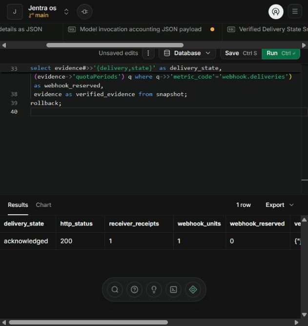

# Hosted signed delivery and usage accounting verified

The approved Synthetic RT1 test succeeded. One signed HTTPS request returned
HTTP 200, the hosted receiver persisted one receipt containing the exact
397-byte payload, and the original invocation settled one webhook unit with
zero outstanding reservation. No automatic retry or additional AI call occurred.

The independent hosted database read was taken at
**2026-11-03T07:42:15.299583Z**. All 18 delivery reconciliation checks passed.
The earlier AI result remains settled at 247 tokens, with one model invocation.

## Actual result

| Check | Verified result |
| --- | --- |
| Sender response | HTTP 200, `acknowledged` |
| Controlled signed requests | 1; automatic retries 0 |
| Original delivery | `091e0c08-5038-4169-8e28-ffde9e0d51c8`, acknowledged at attempt 2 |
| Original event | `a10d0346-b9c6-474a-a3fc-d643602b8b5e` |
| Original invocation | `257b49a7-0be2-4319-b6bd-a574ae9bb59f` |
| Original usage event | `ebc3757e-6a2c-4458-b7a2-1db39d473bef` |
| Receiver receipt | Exactly 1 for the same event, subscription and RT1 scope |
| Stored payload | Exact canonical bytes match sender; 397 bytes |
| Payload SHA-256 | `18cdd33ad12eafa9927d8e1717e2f4e1aeb06729e440556143ebf0a3890fdf4a` |
| Webhook usage | 1 settled; 0 outstanding quota reservation |
| AI result | 1 settled invocation, 247 tokens; unchanged |
| Other deliveries | Four historical fixtures remain unmaterialized |
| Background schedules | All three remain paused; no scheduler tick |

The request went to the existing hosted receiver:
`https://xpdoufauvrbdmxgngetv.supabase.co/functions/v1/wave5-receiver/accept`.
Its reviewed handler validates the HMAC, exact bytes, committed event, active
scope, subscription/key version and lease before persisting its receipt.
The receiver's nine modules matched the fresh hosted source readback.

The successful worker result was captured at `07:40:28.947Z`; the stored
attempt outcome records HTTP 200, and independent accounting confirms the
usage event. The sender's capture-time receipt retains
`persistedReceiptAndAccountingVerified:false`; the later reconciliation
receipt establishes that verification as true without rewriting history.

## Approved recovery applied

The owner's explicit approval is recorded in
[external-delivery-owner-approval.json](../verification/ai-integrations-test-20261103/external-delivery-owner-approval.json),
bound to candidate SHA-256
`1472e0db02e1efa998bc46a3a2ce03b691d2e68d933389c269c762a378079823`.

The existing synthetic billing actor completed genuine password/MFA sign-in.
Normal subscription APIs activated version 6 with the same free synthetic
plan and five seats. The trial runs from **1:08:04 PM to 1:38:04 PM on
3 November 2026, Asia/Colombo**. The RT1 runtime scope and edge authority
expire at **1:38:37 PM**. No automatic renewal was configured.

The guarded maintenance transaction repaired only the original delivery's
unused expired period and created its approved 60-second attempt 2 lease.
Attempt 1 and the genuine earlier `not_sent` MFA review remain unchanged.
No replacement delivery, invocation or business event was created.

The worker ran locally against the existing hosted scoped RPCs and made the
single DNS-pinned HTTPS POST to the hosted receiver. This verifies actual
external transport, receiver persistence and usage accounting. Hosted scheduled
dispatch, UI model submission and native Windows owner acceptance remain
separate, unverified gates; background jobs were not enabled by this test.

Plan, seat count, quota cap, three reader permissions, integration registrations,
key references and all ten reviewed database functions/permissions remained
unchanged. No paid plan, payment method, AI request, deployment or schema
migration was added by this recovery.

## Evidence

- [Actual signed request intent](../verification/ai-integrations-test-20261103/external-delivery-signed-request-intent.json)
- [Actual HTTP result](../verification/ai-integrations-test-20261103/external-delivery-send-result.json)
- [Independent hosted accounting SQL](../verification/ai-integrations-test-20261103/external-delivery-accounting.sql)
- [Actual hosted accounting rows](../verification/ai-integrations-test-20261103/external-delivery-accounting.json)
- [18 passing delivery reconciliation checks](../verification/ai-integrations-test-20261103/external-delivery-usage-reconciled.json)
- [Approved trial activation](../verification/ai-integrations-test-20261103/external-delivery-trial-activated.json)
- [Approved authority renewal](../verification/ai-integrations-test-20261103/external-delivery-authority-renewed.json)
- [Committed original-delivery lease](../verification/ai-integrations-test-20261103/external-delivery-leased-job.json)
- [Earlier successful AI result](ai-integrations-v12-hosted-result-20261103.md)
- [Preserved preparation and review](ai-integrations-external-delivery-review-20261103.md)

