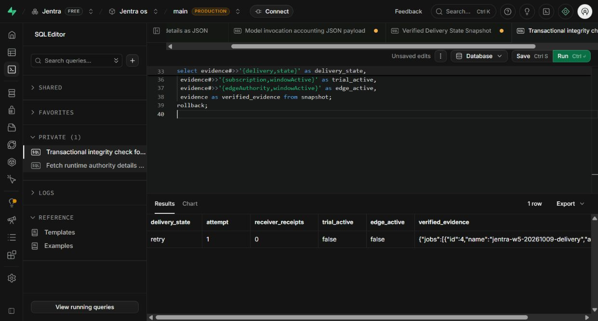

# Original RT1 delivery: prepared recovery and one free test

This review preserves the prepared state before approval. The owner subsequently
approved the exact plan, and the [actual hosted result](ai-integrations-external-delivery-result-20261103.md)
confirms HTTP 200, one receiver receipt and one settled webhook unit.

At preparation time, no recovery was committed and no delivery was sent.
The preapproval hosted read at **2026-11-03T07:20:13.876906Z** confirmed the original
delivery remains `retry`, attempt 1, with zero receiver receipts, no delivery
reservation and no delivery usage event. All three scheduled jobs remain paused.
The successful AI invocation remains settled at 247 tokens, with one model
invocation in total. No further AI request is part of this plan.

## Confirmed cause and evidence

The original lease-only test ended with a genuine MFA `not_sent` review on
13 October. Its delivery retained the unused October billing period, which
ended on 20 October. The installed reservation function rejects expired periods
and requires the active subscription's exact period. Renewing the trial alone
would therefore leave this delivery unable to reserve usage.

The trial, RT1 runtime scope and separate edge authority have all expired.
The signing-key references still have Vault records; no key value was selected
by this preflight. The hosted receiver is ACTIVE at version 8. Its nine
executable modules match the reviewed source, including opaque service-key
headers and signed-payload validation. No receiver deployment is needed.

The generic worker claim can materialize four other queued historical test
fixtures. This plan instead prepares a maintenance transaction that leases
only the original delivery and passes that existing lease to the worker.

## Exact proposed action

Project: `xpdoufauvrbdmxgngetv`, Synthetic RT1 only.

| Identity | Preserved value |
| --- | --- |
| Delivery | `091e0c08-5038-4169-8e28-ffde9e0d51c8` |
| Event | `a10d0346-b9c6-474a-a3fc-d643602b8b5e` |
| Invocation | `257b49a7-0be2-4319-b6bd-a574ae9bb59f` |
| Usage event | `ebc3757e-6a2c-4458-b7a2-1db39d473bef` |
| Forecast | `5719b23f-757b-4da8-8cf7-47d82103415c` |

1. Refresh the hosted preflight and sign in with the existing synthetic billing
   actor using a genuine password/MFA challenge. Through the normal subscription
   APIs, activate one 30-minute trial with the same plan and five seats. This
   advances subscription version 5 to 6. It adds no payment method or paid plan.
2. Renew the existing RT1 runtime scope and edge authority for 30 minutes.
   The existing keys, subscription registrations and paused jobs stay intact.
3. In a guarded transaction, move only the original delivery's unused period to
   the new trial period and create attempt 2 with a new 60-second lease. Preserve
   attempt 1, its MFA review, all original identities, and the committed event.
   The existing server authorization function must approve the lease.
4. Run the reviewed worker locally against the hosted scoped RPCs. Reserve one
   `webhook.deliveries` unit, obtain the existing v1 signing key through the
   scoped server API, and make at most **one** signed, DNS-pinned HTTPS POST to:
   `https://xpdoufauvrbdmxgngetv.supabase.co/functions/v1/wave5-receiver/accept`.
   The payload contains only the committed synthetic event's IDs, type,
   definition version and source hash. Credentials and signatures are not logged.
5. Capture the actual response and independently reconcile the persisted
   receiver receipt, payload digest, attempt outcome and usage event. On success,
   require one settled webhook unit and zero outstanding webhook reservation.
   Any rejection, timeout or uncertain outcome stops the run without a retry.

This is controlled local dispatch to the hosted receiver. It does not establish
hosted scheduled-dispatch acceptance. No new delivery/invocation ID, forecast
command, background job, model request, database function or schema migration
is included. The existing webhook cap of 100 and the reader's three permissions
remain unchanged. The renewed authority expires automatically after 30 minutes.

## Completed validation

The frozen recovery SQL passed a hosted rollback trial at
`2026-11-03T07:19:58.943832Z`: the original event was authorized for attempt 2,
only one head existed, no reservation or receipt existed, and all jobs remained
paused. The independent read afterward confirmed the repair was rolled back.
No human MFA or service-role session is claimed by the temporary database
fixture used inside that rollback trial.

Thirteen focused runner tests passed. They cover preserved IDs/source,
destination and payload checks, expired leases, old reservations, an enabled
scheduler, period duration, and prevention of a second request after HTTP
success, HTTP failure, transport uncertainty or an intent-write failure.
The runner syntax check and offline validation passed with no network calls or
secret reads. All 28 final preservation/review checks passed.

The first rollback validation stopped at its source guard because accessibility
rendering normalized SQL source whitespace. Exact base64 bytes and server
digests resolved that capture issue without relaxing the guard. A subsequent
read-only query-generation error was corrected before any successful read.
Both failed checks are retained as separate evidence.

## Reviewable artifacts

All paths below are relative to this report.

- [Frozen plan and hashes](../verification/ai-integrations-test-20261103/external-delivery-recovery-candidate.json)
- [Authority renewal SQL](../verification/ai-integrations-test-20261103/external-delivery-renew-authority.sql)
- [Original-delivery period repair and lease SQL](../verification/ai-integrations-test-20261103/external-delivery-lease.sql)
- [Rollback-only SQL](../verification/ai-integrations-test-20261103/external-delivery-rollback.sql)
- [Actual passing rollback result](../verification/ai-integrations-test-20261103/external-delivery-rollback-final-result.json)
- [Final hosted state](../verification/ai-integrations-test-20261103/external-delivery-preapproval-final.json)
- [Receiver readback](../verification/ai-integrations-test-20261103/external-receiver-readback.json)
- [28 verification checks](../verification/ai-integrations-test-20261103/external-delivery-review-verified.json)
- [One-request runner](../../tools/wave5/run_external_delivery_20261103.mjs)
- [Focused tests](../../tools/wave5/external_delivery_once_20261103.test.mjs)

Frozen candidate SHA-256:
`1472e0db02e1efa998bc46a3a2ce03b691d2e68d933389c269c762a378079823`.
The candidate binds six prepared artifacts and eleven execution-source files.
It must be re-reviewed if those bindings or the hosted preimages change.

The earlier AI approval explicitly excluded delivery resends. The owner then
gave [separate approval of this exact recovery and one-request plan](../verification/ai-integrations-test-20261103/external-delivery-owner-approval.json).
The frozen candidate and preapproval proof remain intact.

