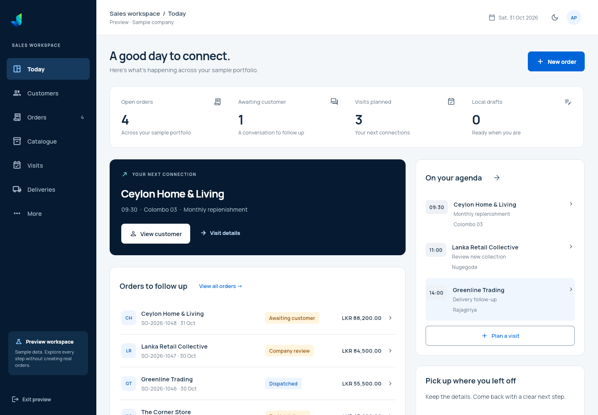
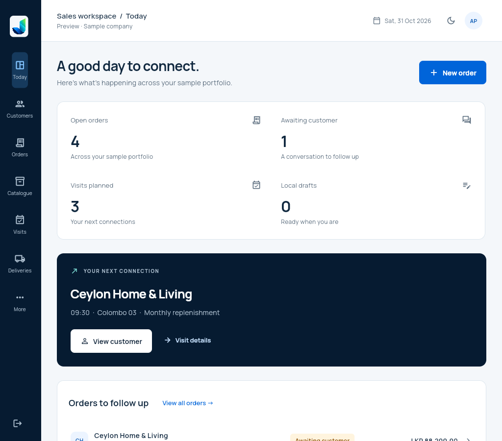
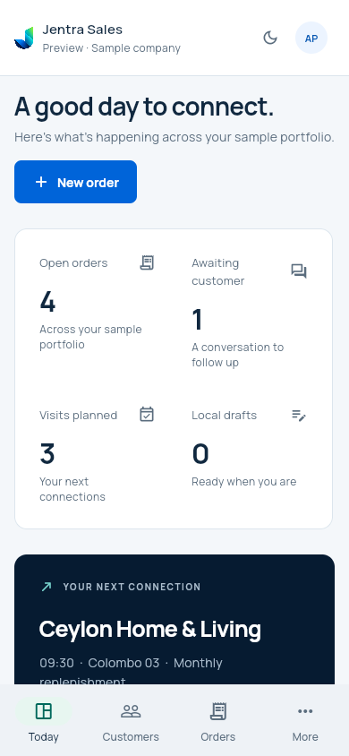

# Jentra Sales development preview

Build: 30 October 2026. Verification finalized: 31 October 2026.
This is an interactive synthetic preview, version **0.1.0+1**.

| Deliverable | Verified result |
| --- | --- |
| [Web preview](https://jentra-os-sales.web.app) | Firebase `jentra-os`, dedicated `jentra-os-sales` site |
| [Android download ZIP](https://jentra-os-sales.web.app/downloads/Jentra-Sales-0.1.0-1-Development-APK.zip) | Contains the identical development-signed ARM64 APK |
| Android application | `com.jentra.sales.dev`, 23,079,169 bytes, signature verified |
| Source inputs | 180 matching SHA-256 inputs before/after compilation and at handoff |
| Sales tests/analyzer | 19 passed; no analyzer issues |
| Hosted files | All 50 preview/live files match SHA-256 and size |
| Hosting behavior | No-store/CSP/frame/referrer headers, WASM MIME, five 404 checks and SPA routing pass |
| Ordinary Chrome preview | 3/3 viewports pass |
| Live Chrome with HTTP/3 disabled | 3/3 viewports pass; no runtime errors, failed requests or backend requests |
| Ordinary Chrome live | Latest run 2/3; desktop reload startup timed out; acceptance remains open |

Firebase version **`ff9d9bdb19326df5`** was promoted from preview to live. A later
preview-only transport-header experiment was ignored by Firebase and reverted;
live stayed on the original verified version. The cause of intermittent normal
Chrome startup on this network is unconfirmed. No global browser setting was
changed. The alternate Firebase domain did not eliminate that observation.

Choose **Explore the preview** on the sign-in screen. Customers, catalogue,
order entry/review, exact fractional quantities, protected local drafts,
visits and separate response/approval/delivery states can be inspected.
Drafts expire after 24 hours and are never submitted automatically.

Live customer portfolios, authoritative prices/tax/credit/order submission,
company discount approvals, verified customer/delivery email responses and
durable inbox remain pending. No database migration or sender was activated.
English only; store signing, iOS, physical-device accessibility, normal-browser
startup acceptance and real-company/S1 acceptance remain open.

The full live test verifies exact 1.125 × LKR 1,250 = LKR 1,406.25 review,
save/reload recovery and keep/discard protection. Initial quantity-entry failures
came from automation focus/DOM-fill behavior; the native-input diagnostic and
passing keyboard-driven flow are retained. The harness separately records only
requests cancelled by its deliberate reload/teardown, preserving other failures.

See [verification.json](verification.json), [source-manifest.json](source-manifest.json),
[public-manifest.json](public-manifest.json), [preview-browser.json](preview-browser.json),
[live-browser.json](live-browser.json) and [live-normal-browser.json](live-normal-browser.json).
The SHA-256 values and APK/ZIP sizes are in `verification.json`; `apk-archive.json`
proves the ZIP entry equals the direct APK. The screenshots below are from the
passing live TCP run.

